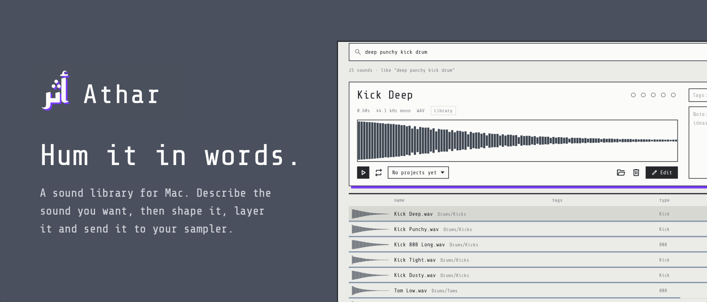
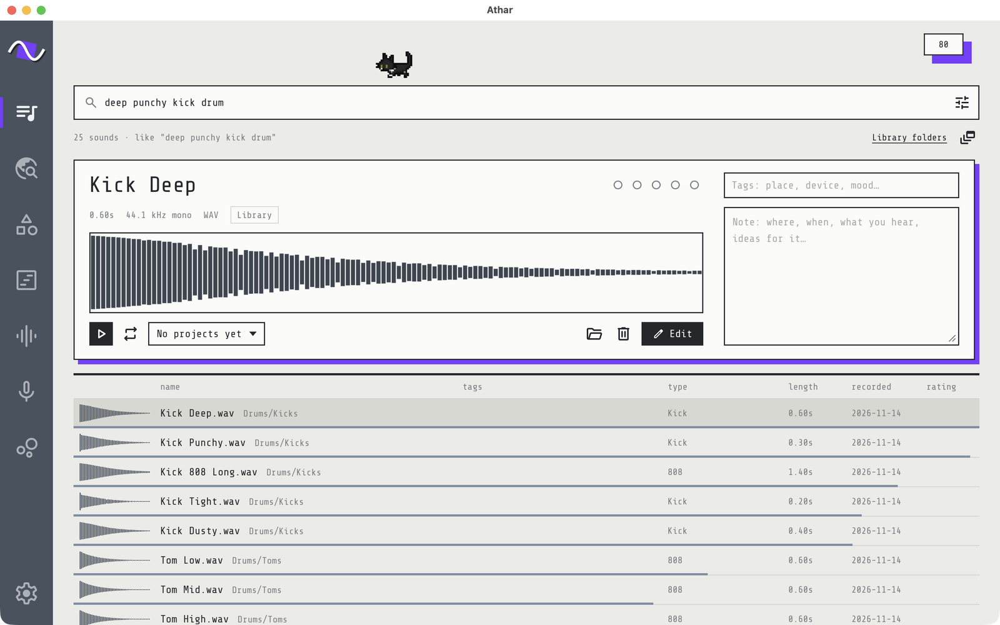
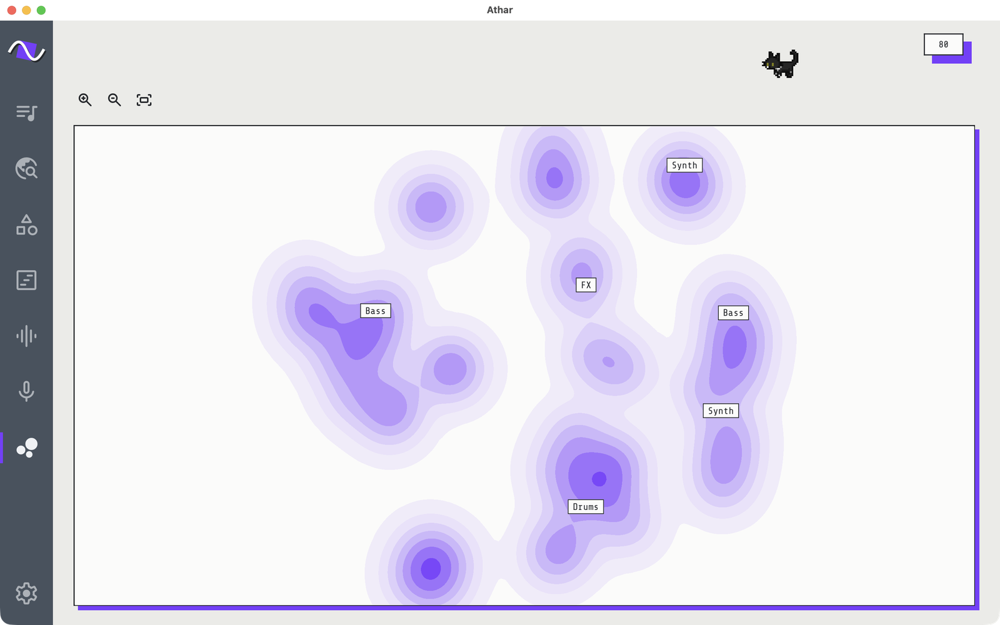
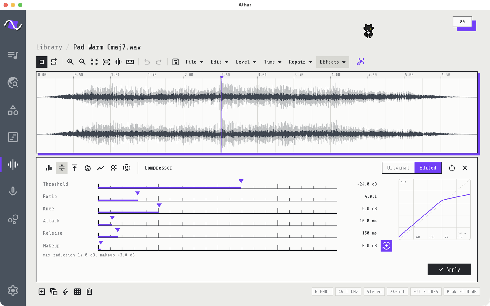
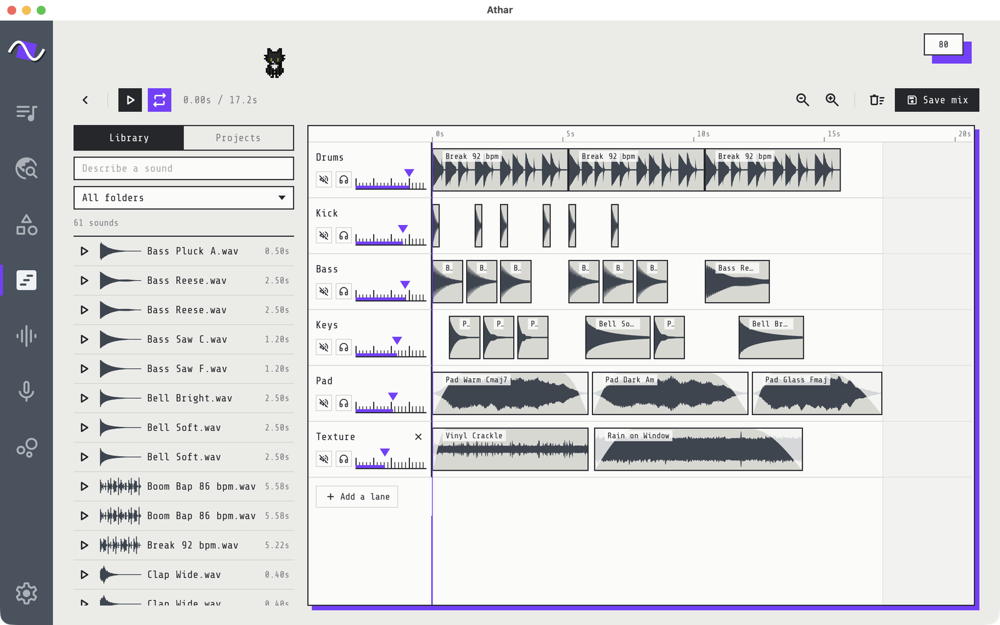
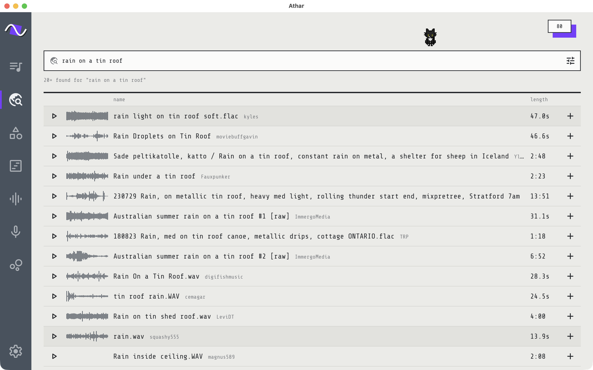

  

# Athar

Athar is a sound library for Mac. Point it at your sample folders, type what you want to hear, and it finds the sounds that match. Then edit them, layer them, and export a kit for your sampler.

Everything runs on your Mac. Your sounds stay on your disk and the search works offline.

## Find sounds by describing them

Type "deep punchy kick drum", "rain on a window" or "warm pad" and Athar ranks your whole library by how close each sound is. The search runs on CLAP (Contrastive Language-Audio Pretraining), an AI model trained on sounds paired with their descriptions. It has learned what a "punchy kick" or "rain" sounds like, so it compares your words with the audio itself. Rate, tag and annotate sounds as you go.

## See your library as a map

The Map lays out every sound by how it sounds. Kicks gather in one region, pads in another, and the odd recordings you forgot about sit somewhere in between. Zoom in and click around to browse by ear.

## Edit without fear

The editor works on a copy, so your original files are never changed. Trim, fade, normalize, change speed or pitch, tune a sound to a note, make it loop, remove clicks and noise, or slice a recording into separate hits.

Seven effects come built in: parametric EQ, compressor, maximizer, saturation, attack and tail shaping, lo-fi and noise reduction. You hear every change as you move a control, and one switch compares the edit with the original.

New to audio? Click the cat. It explains what the open effect does and what each control is for, in plain language.

## Layer sounds in the Arranger

Drag sounds onto named lanes, line them up, set levels and fades, and loop the result. Save mix writes what you hear as one new file.

## Discover new sounds

Search free online archives (Openverse, the Internet Archive, and Freesound with your own key) from inside the app. A sound you add is downloaded into the project you choose, with its licence and source link saved in its note.

## And also

- **Projects** collect the sounds for a track or a kit in their own folder, as copies, so the library stays untouched.
- **Recorder** captures takes from your microphone or audio interface, ready to trim and save.
- **Watched folders** pick up new files as you add them.
- Reads WAV, AIFF, FLAC, MP3, OGG, M4A, AAC and WavPack.

## Install

Athar runs on Apple silicon Macs with macOS 12 or later.

1. Download `Athar.zip` from the [latest release](../../releases/latest).
2. Unzip it and drag Athar to your Applications folder.
3. Open it. The app is not notarized by Apple, so the first launch needs your approval: open System Settings, go to Privacy & Security, and choose Open Anyway.
4. Drop a folder of sounds onto the window. Athar analyses each file once, and search is ready when it finishes.

## From source

The app is Rust with a [Tauri](https://tauri.app) window. `core/` holds decoding, search and audio processing, `app/` the macOS app built on it, and `app/ui/` the interface the window shows.

You need [Rust](https://rustup.rs), the Tauri CLI (`cargo install tauri-cli`), [uv](https://docs.astral.sh/uv/) to export the search model once, and Node.js for the interface's type checks.

1. Export the search model into `build/`: `uv run packaging/export_model.py`, then `uv run packaging/quantize_audio.py`.
2. Build the app with `app/bundle.sh`. It writes `app/target/release/bundle/macos/Athar.app`.
3. Run the checks: `cargo test --release` in `core/` and in `app/`, and `npm install`, then `npm run check` for the interface.

## Licence

Athar is released under the MIT licence, in `LICENSE`. The bundled fonts keep their own licences, in `app/ui/fonts/`.
